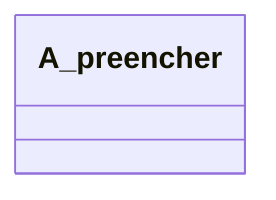
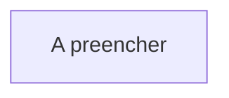

Crie a estrutura de contexto inicial deste projeto. Não preencha conteúdo: crie diretórios, arquivos, o cabeçalho padrão de cada arquivo e as seções vazias. O conteúdo será escrito depois, com o time, e mantido sincronizado a cada loop.

## Estrutura

```
AGENTS.md
context/
  product/
    product.md
    glossary.md
    business_rules.md
    use_cases.md
  ux/
    design.md
    usability.md
  engineering/
    domain_model.md
    architecture.md
    code_conventions.md
  adlc/
    agent_development_lifecycle.md
    backlog.md
    loop_report.md
    loop_reports/
    lessons_learned.md
```

Em `context/adlc/loop_reports/`, crie só um arquivo `.gitkeep`. Cada loop gera ali o seu report (`loop-001.md`, `loop-002.md`...).

## Cabeçalho padrão

Todo arquivo de `context/` começa exatamente assim:

```
# <Título>

> Propósito: <uma frase>
> Atualizar quando: <gatilho>
> Relacionados: <links relativos, ou "nenhum">
> Última atualização: <AAAA-MM-DD de hoje> · fundação
```

Depois do cabeçalho, as seções do arquivo como títulos `##`, cada uma com a linha `<!-- a preencher -->`.

## Arquivos

Para cada arquivo: título, propósito, gatilho de atualização, relacionados e seções. Use exatamente estes valores.

### context/product/product.md
- Título: Produto
- Propósito: Visão de alto nível do produto: o que é, que problema resolve e para quem.
- Atualizar quando: mudar o problema, o público ou o escopo do produto.
- Relacionados: glossary.md
- Seções: Visão; Problema; Usuários; Proposta de valor; Escopo (dentro e fora); Métricas de sucesso

### context/product/glossary.md
- Título: Glossário
- Propósito: Termos do produto e o seu significado, para que pessoas e agentes usem as mesmas palavras.
- Atualizar quando: surgir um termo novo ou um termo mudar de sentido.
- Relacionados: nenhum
- Seções: Termos (com uma tabela vazia de colunas Termo, Significado, Onde aparece)

### context/product/business_rules.md
- Título: Regras de negócio
- Propósito: Regras de negócio reutilizáveis entre casos de uso, cada uma com um identificador RN-NNN.
- Atualizar quando: uma regra for criada, alterada ou deixar de valer.
- Relacionados: glossary.md
- Seções: Regras; Modelo de regra (em comentário HTML: RN-001, Nome, Descrição, Aplica-se a)

### context/product/use_cases.md
- Título: Casos de uso
- Propósito: Funcionalidades a desenvolver, com os critérios de aceite que guiam os testes e definem quando está pronto.
- Atualizar quando: um caso de uso for criado, mudar ou tiver os critérios de aceite revistos.
- Relacionados: business_rules.md, glossary.md, ../engineering/domain_model.md
- Seções: Índice; Casos de uso; Modelo de caso de uso (em comentário HTML: UC-001, Ator, Objetivo, Pré-condições, Fluxo principal, Fluxos alternativos, Regras aplicadas RN-NNN, Critérios de aceite no formato Dado, Quando, Então)

### context/ux/design.md
- Título: Design
- Propósito: Diretrizes de design da interface gráfica.
- Atualizar quando: mudar um padrão visual ou entrar um componente novo.
- Relacionados: usability.md
- Seções: Princípios visuais; Cores; Tipografia; Componentes; Layout

### context/ux/usability.md
- Título: Usabilidade
- Propósito: Diretrizes de usabilidade e acessibilidade.
- Atualizar quando: uma diretriz mudar ou um teste com usuários trouxer um aprendizado.
- Relacionados: ../product/product.md
- Seções: Princípios; Acessibilidade; Feedback e mensagens de erro; Linguagem

### context/engineering/domain_model.md
- Título: Modelo de domínio
- Propósito: Entidades e dados que o produto trata, e como se relacionam.
- Atualizar quando: uma entidade, atributo ou relacionamento mudar.
- Relacionados: ../product/glossary.md, ../product/business_rules.md
- Seções: Entidades; Relacionamentos; Diagrama (com o bloco abaixo)



### context/engineering/architecture.md
- Título: Arquitetura
- Propósito: Visão geral da arquitetura no modelo C4, diretrizes arquiteturais e registro das decisões.
- Atualizar quando: uma decisão arquitetural for tomada ou revista.
- Relacionados: domain_model.md, code_conventions.md
- Seções: Visão geral; C4 nível 1: Contexto (bloco mermaid abaixo); C4 nível 2: Contêineres (bloco mermaid abaixo, trocando C4Context por C4Container); Diretrizes; Decisões arquiteturais (ADR); Modelo de ADR (em comentário HTML: ADR-001, Status, Contexto, Decisão, Consequências)

```mermaid
C4Context
  title A preencher
```

### context/engineering/code_conventions.md
- Título: Convenções de código
- Propósito: Convenções que os agentes de código devem seguir.
- Atualizar quando: uma convenção for criada ou mudar, inclusive por uma lição aprendida.
- Relacionados: architecture.md
- Seções: Linguagem e estilo; Estrutura de pastas; Nomes; Testes; Commits; O que evitar

### context/adlc/agent_development_lifecycle.md
- Título: Agent Development Lifecycle (ADLC)
- Propósito: Como funciona o loop de desenvolvimento: etapas, artefatos e checkpoints humanos (HITL).
- Atualizar quando: o processo mudar ou uma lição aprendida alterar uma etapa.
- Relacionados: backlog.md, loop_report.md, lessons_learned.md, ../product/use_cases.md
- Seções: Visão geral; Etapas; Checkpoints humanos (HITL); Fluxo (bloco mermaid abaixo); Artefatos por etapa; Sincronização do contexto



### context/adlc/backlog.md
- Título: Backlog
- Propósito: Funcionalidades em ordem de prioridade, uma por loop.
- Atualizar quando: um loop começar ou terminar, ou a prioridade mudar.
- Relacionados: ../product/use_cases.md
- Seções: Em andamento; Próximos (em ordem); Concluídos; Fora do escopo; Modelo de item (em comentário HTML: número, nome curto, caso de uso UC-NNN, resultado visível ao final)

### context/adlc/loop_report.md
- Título: Registro dos loops
- Propósito: Registro geral dos loops executados, com link para o report de cada um em loop_reports/.
- Atualizar quando: um loop terminar.
- Relacionados: backlog.md, lessons_learned.md
- Seções: Loops executados (com uma tabela vazia de colunas Loop, Data, Item do backlog, Resultado, Report); Modelo de report do loop (em comentário HTML: Loop NNN, Data, Item do backlog, Plano, O que foi feito, Testes, Revisão e decisões, Contexto atualizado, Lições)

### context/adlc/lessons_learned.md
- Título: Lições aprendidas
- Propósito: O que cada loop ensinou, e onde a lição foi aplicada no contexto.
- Atualizar quando: no final de cada loop.
- Relacionados: loop_report.md
- Seções: Lições; Modelo de lição (em comentário HTML: LL-001, Data, Loop, O que aconteceu, Lição, Onde foi aplicada)

## AGENTS.md

O AGENTS.md é o índice do contexto. Fica curto: só onde cada arquivo vive e regras gerais que não cabem em outro lugar.

Se o AGENTS.md não existir, crie com o título do projeto e as duas seções abaixo. Se existir, acrescente as duas seções ao final e mantenha tudo o que já está lá.

```
## Contexto do projeto

O contexto do projeto vive em context/. Leia os arquivos relevantes antes de agir.

- Produto: context/product/ (product, glossary, business_rules, use_cases)
- Experiência do usuário: context/ux/ (design, usability)
- Engenharia: context/engineering/ (domain_model, architecture, code_conventions)
- Processo de desenvolvimento: context/adlc/ (agent_development_lifecycle, backlog, loop_report, lessons_learned)

## Regras gerais

- O contexto anda junto com o código. Ao mudar algo coberto por um arquivo de context/, atualize esse arquivo na mesma entrega, seguindo o "Atualizar quando" do cabeçalho.
- Siga o processo descrito em context/adlc/agent_development_lifecycle.md.
- Não suponha o que não está no contexto. Pergunte.
```

## Regras

- Não preencha conteúdo. Só estrutura, cabeçalhos, seções e os modelos em comentário indicados acima.
- Não sobrescreva arquivos existentes. Se um arquivo já existir, não altere e informe no final.
- Use só as referências listadas em "Relacionados", como links relativos em Markdown.
- Não crie outros arquivos além dos listados. Não faça commit.
- Ao terminar, mostre a árvore de context/ e a lista do que foi criado e do que foi pulado.
