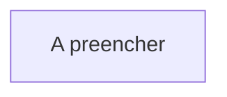

# Agent Development Lifecycle (ADLC)

> Propósito: Como funciona o loop de desenvolvimento: etapas, artefatos e checkpoints humanos (HITL).
> Atualizar quando: o processo mudar ou uma lição aprendida alterar uma etapa.
> Relacionados: [backlog.md](backlog.md), [loop_report.md](loop_report.md), [lessons_learned.md](lessons_learned.md), [../product/use_cases.md](../product/use_cases.md)
> Última atualização: 2026-11-15 · fundação

## Visão geral

<!-- a preencher -->

## Etapas

<!-- a preencher -->

## Checkpoints humanos (HITL)

<!-- a preencher -->

## Fluxo

## Artefatos por etapa

<!-- a preencher -->

## Sincronização do contexto

<!-- a preencher -->
