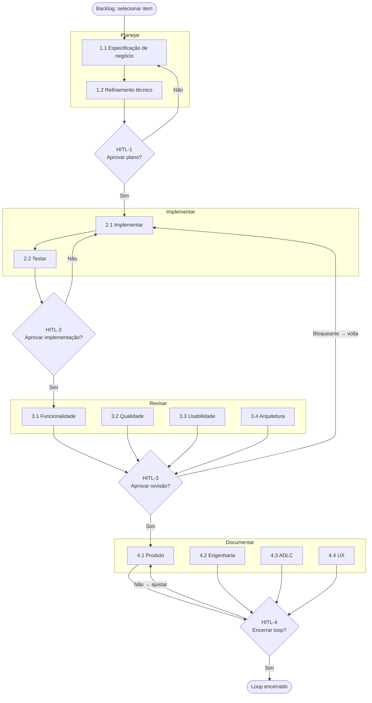

# Agent Development Lifecycle (ADLC)

> Propósito: Como funciona o loop de desenvolvimento: etapas, artefatos e checkpoints humanos (HITL).
> Atualizar quando: o processo mudar ou uma lição aprendida alterar uma etapa.
> Relacionados: [backlog.md](backlog.md), [loop_report.md](loop_report.md), [lessons_learned.md](lessons_learned.md), [../product/use_cases.md](../product/use_cases.md)
> Última atualização: 2026-11-16 · configuração do Claude Code

## Visão geral

Cada loop entrega um caso de uso completo (backend + frontend + testes + contexto atualizado). O loop passa por quatro fases em sequência: **Planejar**, **Implementar**, **Revisar** e **Documentar**. Há um checkpoint humano (HITL) entre cada fase. Se a Revisão encontrar problemas, o loop retorna à Implementação.

## Ferramentas

O loop roda em duas ferramentas, com a mesma estrutura de agentes e skills:

| | IBM Bob | Claude Code |
|---|---|---|
| Agentes (um por etapa) | `.bob/agents/` | `.claude/agents/` |
| Skills (`/loop-start`, fases, `/context-*`) | `.bob/skills/` | `.claude/skills/` |
| Instruções do projeto | `AGENTS.md` | `CLAUDE.md` (importa o `AGENTS.md`) |

Ao mudar um agente ou uma skill numa ferramenta, faça a mesma mudança na outra. O campo "Modo Bob" de cada etapa tem esta equivalência no Claude Code:

| Modo Bob | Claude Code |
|---|---|
| Plan | Agente só com ferramentas de leitura (`Read, Grep, Glob`); não altera arquivos |
| Agent | Agente com ferramentas de edição e terminal, conforme a etapa |
| Ask | Conversa com o humano, sem alterar arquivos |

## Etapas

### 1. Planejar

Agentes especializados executados em sequência.

**1.1 Especificação de negócio**
- Objetivo: detalhar o caso de uso selecionado — confirmar critérios de aceite, regras de negócio aplicáveis e impactos no contexto de produto.
- Modo Bob: Plan
- Entradas: item do backlog, UC-NNN, business_rules.md, glossary.md
- Saídas: especificação de negócio aprovada (texto ou notas no loop report)
- Lê: use_cases.md, business_rules.md, glossary.md
- Atualiza: nenhum (apenas propõe; mudanças em product/ são aprovadas pelo humano)

**1.2 Refinamento técnico**
- Objetivo: traduzir a especificação em tarefas de implementação — interfaces IPC, queries de banco, componentes React, testes necessários.
- Modo Bob: Plan
- Entradas: especificação de negócio aprovada, domain_model.md, architecture.md, code_conventions.md
- Saídas: lista de tarefas técnicas aprovada
- Lê: domain_model.md, architecture.md, code_conventions.md
- Atualiza: nenhum

> **HITL-1 — Checkpoint pós-Planejamento**
> Perguntas de aprovação:
> - A especificação de negócio reflete o UC corretamente?
> - As tarefas técnicas cobrem todos os critérios de aceite?
> - Há dependências ou riscos não mapeados?
> Só avança para Implementar com aprovação explícita.

---

### 2. Implementar

Agentes especializados executados em sequência.

**2.1 Implementar**
- Objetivo: escrever o código das tarefas definidas no refinamento técnico, seguindo architecture.md e code_conventions.md.
- Modo Bob: Agent
- Entradas: lista de tarefas técnicas aprovada
- Saídas: código commitado (feat/fix) na branch do loop
- Lê: architecture.md, code_conventions.md, domain_model.md
- Atualiza: código-fonte

**2.2 Testar**
- Objetivo: escrever e rodar os testes unitários e de integração que cobrem os critérios de aceite do UC.
- Modo Bob: Agent
- Entradas: código implementado, critérios de aceite do UC
- Saídas: testes passando, cobertura mínima atendida
- Lê: use_cases.md, code_conventions.md
- Atualiza: código-fonte (arquivos de teste)

> **HITL-2 — Checkpoint pós-Implementação**
> Perguntas de aprovação:
> - Os testes passam sem falhas?
> - O comportamento visível corresponde ao critério de aceite?
> - Há débito técnico relevante a registrar?
> Só avança para Revisar com aprovação explícita.

---

### 3. Revisar

Agentes especializados executados em paralelo (swarm). Se qualquer agente apontar problema bloqueante, o loop retorna à fase Implementar.

**3.1 Funcionalidade**
- Objetivo: verificar se todos os critérios de aceite do UC foram atendidos.
- Modo Bob: Ask / Plan
- Lê: use_cases.md, código implementado

**3.2 Qualidade**
- Objetivo: verificar aderência às convenções de código, ausência de `any`, cobertura de testes, sem erros de lint.
- Modo Bob: Ask / Plan
- Lê: code_conventions.md, código implementado

**3.3 Usabilidade**
- Objetivo: verificar se a interface entregue segue usability.md e design.md.
- Modo Bob: Ask / Plan
- Lê: usability.md, design.md, código implementado

**3.4 Arquitetura e convenções**
- Objetivo: verificar se as decisões de arquitetura foram respeitadas (ADRs, separação main/renderer, IPC tipado).
- Modo Bob: Ask / Plan
- Lê: architecture.md, code_conventions.md, código implementado

> **HITL-3 — Checkpoint pós-Revisão**
> Perguntas de aprovação:
> - Todos os agentes de revisão aprovaram sem bloqueantes?
> - Problemas menores foram registrados como débito ou lição?
> - O loop pode ser considerado concluído?
> Se houver bloqueante: retorna ao HITL-2 após correção.
> Só avança para Documentar com aprovação explícita.

---

### 4. Documentar

Agentes especializados executados em paralelo.

**4.1 Produto**
- Objetivo: atualizar context/product/ com qualquer mudança que o loop introduziu (novos termos, regras, ajuste em UC).
- Modo Bob: Agent
- Lê e atualiza: glossary.md, business_rules.md, use_cases.md

**4.2 Engenharia**
- Objetivo: atualizar context/engineering/ com entidades, decisões ou convenções que mudaram.
- Modo Bob: Agent
- Lê e atualiza: domain_model.md, architecture.md, code_conventions.md

**4.3 Agent Development Lifecycle**
- Objetivo: registrar o loop em loop_reports/, atualizar loop_report.md e lessons_learned.md.
- Modo Bob: Agent
- Lê e atualiza: loop_report.md, loop_reports/loop-NNN.md, lessons_learned.md, backlog.md

**4.4 UX**
- Objetivo: atualizar context/ux/ com qualquer mudança que o loop introduziu na interface (novos fluxos, ajuste em componentes, correções de usabilidade).
- Modo Bob: Agent
- Condição: executar somente se o loop alterou a interface (componentes visuais, fluxos de navegação ou comportamento do usuário).
- Lê e atualiza: design.md, usability.md

> **HITL-4 — Checkpoint pós-Documentação**
> Perguntas de aprovação:
> - O contexto reflete o estado atual do código?
> - As lições foram registradas?
> - O próximo item do backlog está claro?
> Loop encerrado após aprovação.

## Checkpoints humanos (HITL)

| ID | Após a fase | Condição para avançar |
|----|-------------|----------------------|
| HITL-1 | Planejar | Especificação e tarefas aprovadas pelo humano |
| HITL-2 | Implementar | Testes passando e comportamento aprovado pelo humano |
| HITL-3 | Revisar | Todos os agentes sem bloqueantes e aprovação do humano; caso contrário, volta para Implementar |
| HITL-4 | Documentar | Contexto sincronizado e loop encerrado pelo humano |

## Fluxo

## Artefatos por etapa

| Etapa | Artefato produzido |
|-------|--------------------|
| 1.1 | Especificação de negócio (notas no loop report) |
| 1.2 | Lista de tarefas técnicas (notas no loop report) |
| 2.1 | Commits de código (feat/fix) |
| 2.2 | Commits de testes, resultado de execução |
| 3.1–3.4 | Relatório de revisão (notas no loop report) |
| 4.1–4.4 | context/ atualizado, loop_reports/loop-NNN.md, loop_report.md, lessons_learned.md |

## Sincronização do contexto

- **Durante o loop**: somente arquivos de código são alterados.
- **Na fase Documentar**: todos os arquivos de context/ afetados pelo loop são atualizados em paralelo pelos agentes 4.1, 4.2, 4.3 e 4.4 (UX somente se a interface mudou).
- Nenhum arquivo de context/ é alterado sem aprovação do humano no HITL correspondente.
