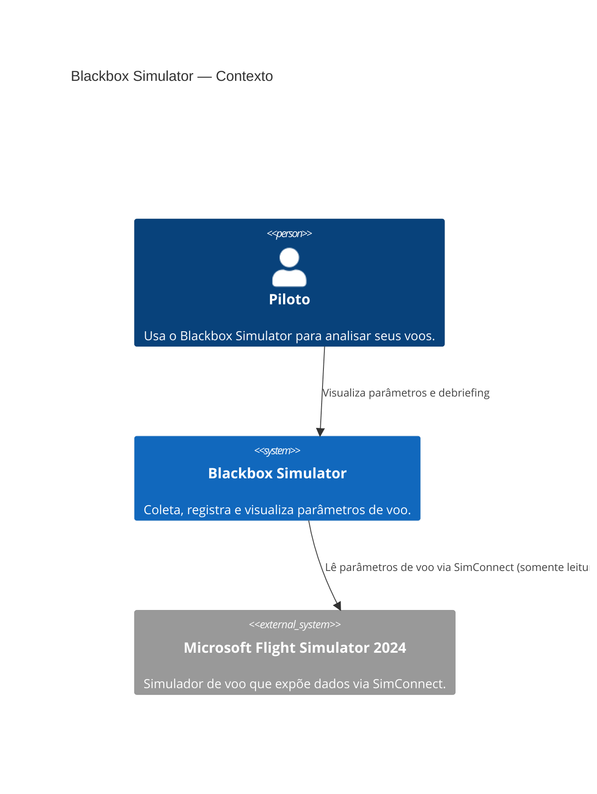
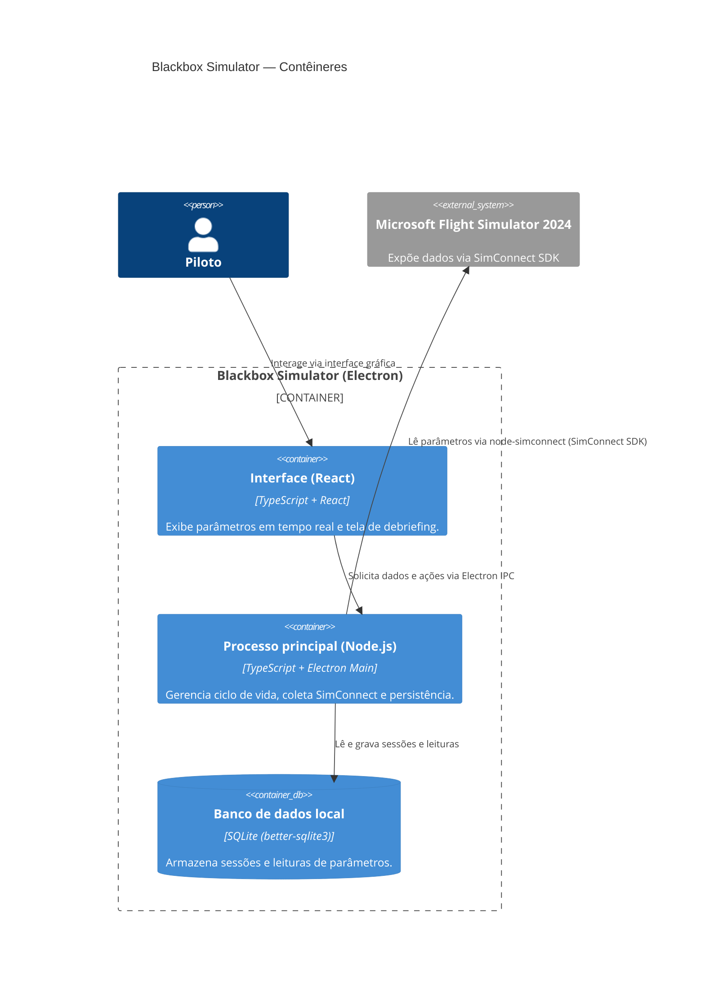

# Arquitetura

> Propósito: Visão geral da arquitetura no modelo C4, diretrizes arquiteturais e registro das decisões.
> Atualizar quando: uma decisão arquitetural for tomada ou revista.
> Relacionados: [domain_model.md](domain_model.md), [code_conventions.md](code_conventions.md)
> Última atualização: 2026-11-16 · instalador Windows

## Visão geral

Blackbox Simulator é uma aplicação desktop para Windows construída com **Electron + React**. O processo principal do Electron (Node.js) é responsável pela coleta de dados via SimConnect e pela persistência em SQLite. O processo de renderização (React) exibe os dados em tempo real e o debriefing. A comunicação entre os dois processos usa IPC do Electron.

## C4 nível 1: Contexto

## C4 nível 2: Contêineres

## Diretrizes

- O processo principal (main) é o único autorizado a acessar o SimConnect e o banco de dados. O renderer nunca acessa diretamente.
- Toda comunicação entre renderer e main usa canais IPC nomeados e tipados. Não usar `remote` do Electron.
- O main opera em modo passivo em relação ao simulador: somente leitura, nunca envia comandos (RN-006).
- A coleta de parâmetros ocorre em intervalo fixo de 1 segundo via polling ao SimConnect.
- O banco SQLite fica em `%APPDATA%\BlackboxSimulator\data.db` para garantir persistência entre atualizações do instalador. Esse caminho é resolvido por `app.getPath('appData')` mais a pasta fixa `BlackboxSimulator`, e por isso não depende do nome do app nem do instalador.
- O renderer não mantém estado de sessão local: busca via IPC ao main sempre que precisar.

## Decisões arquiteturais (ADR)

---

ADR-001
Status: aceita
Contexto: O produto roda localmente no Windows ao lado do Microsoft Flight Simulator 2024. Precisa de instalador, interface gráfica nativa e integração com SimConnect via Node.js.
Decisão: Usar Electron como runtime de desktop com React no processo de renderização e TypeScript em ambos os processos.
Consequências: Instalador de ~100–200 MB. Ecossistema maduro (electron-builder, node-simconnect). Chromium embutido consome mais memória que alternativas como Tauri; aceitável dado o escopo local.

---

ADR-002
Status: aceita
Contexto: O produto precisa persistir sessões e leituras de parâmetros localmente, sem dependência de servidor externo.
Decisão: Usar SQLite via better-sqlite3 como banco de dados local embutido.
Consequências: Sem instalação adicional para o usuário. Banco é um arquivo único em %APPDATA%, fácil de fazer backup. Limitação: sem acesso concorrente multi-processo, adequado para o uso local previsto.

---

ADR-003
Status: aceita
Contexto: O processo principal precisa ler dados do Microsoft Flight Simulator 2024 em tempo real sem interferir no simulador.
Decisão: Usar node-simconnect para integração com o SimConnect SDK da Microsoft via binding direto no processo main do Electron.
Consequências: Integração direta sem processo auxiliar. Dependência de SDK nativo Windows (SimConnect.dll); o produto só funciona no Windows com MSFS instalado. Binding node-simconnect é mantido pela comunidade.

---

ADR-004
Status: aceita
Contexto: O sistema precisa detectar o momento em que o motor da aeronave é ligado no simulador para criar uma nova sessão automaticamente.
Decisão: Usar a variável SimConnect `ENG COMBUSTION:1` (INT32, bool) subscrita via `SimConnectPeriod.SECOND`. A detecção é feita pela transição `false → true` no campo `lastEngineCombustion`. Se o motor já estiver ligado ao iniciar o app, a primeira leitura dispara a sessão automaticamente.
Consequências: Latência máxima de 1 segundo para detectar o início do motor. A variável `ENG COMBUSTION:1` é compatível com MSFS 2024; validação com aeronaves específicas pode ser necessária em versões futuras.

---

ADR-005
Status: aceita
Contexto: O main precisa notificar o renderer sobre eventos assíncronos (sessão iniciada, sessão encerrada) sem que o renderer precise fazer polling.
Decisão: Canais de push são definidos em `shared/ipc-channels.ts`, emitidos via `webContents.send()` no main e expostos via `contextBridge` no preload como funções que registram callback e retornam `() => void` (unsubscribe).
Consequências: Padrão consistente e tipado para todos os eventos assíncronos do sistema.

---

ADR-006
Status: aceita
Contexto: O usuário precisa instalar o app no Windows sem clonar o repositório nem ter Node.js. O `better-sqlite3` é um módulo nativo e precisa ser compilado para Windows e para a versão do Node embutida no Electron, o que o electron-builder não faz com segurança a partir do macOS.
Decisão: Gerar o instalador NSIS (`BlackboxSimulator-Setup-<versão>.exe`, x64) no GitHub Actions, num runner `windows-latest` (`.github/workflows/release-windows.yml`). Uma tag `v*` publica o instalador numa Release do GitHub; uma execução manual só gera o instalador como artefato da execução.
Consequências: Cada versão publicada sai de uma tag, e o instalador é sempre gerado num Windows real. O instalador não é assinado, então o Windows SmartScreen avisa na primeira execução; tirar o aviso exige um certificado de assinatura de código.

---

## Modelo de ADR

<!--
ADR-001
Status:
Contexto:
Decisão:
Consequências:
-->
