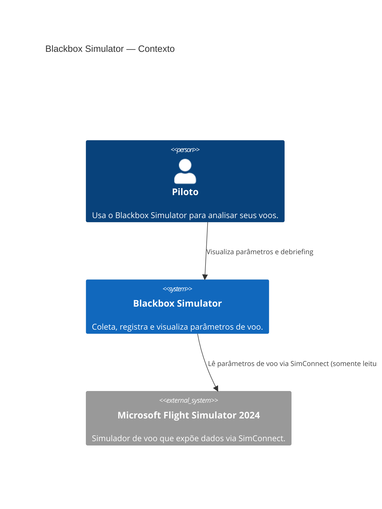
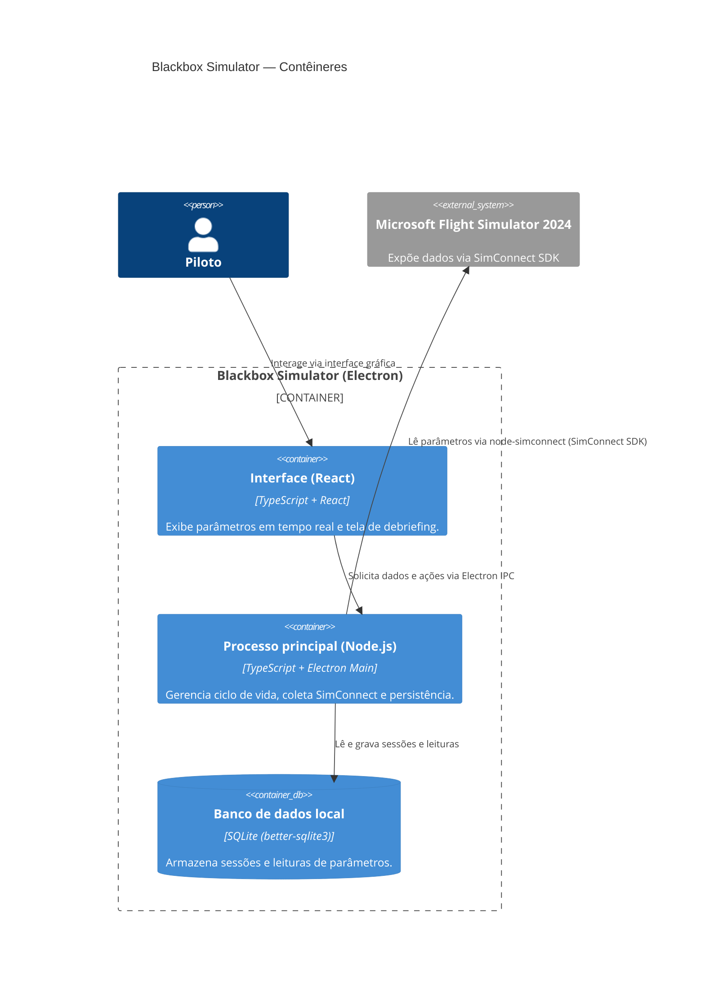

# Arquitetura

> Propósito: Visão geral da arquitetura no modelo C4, diretrizes arquiteturais e registro das decisões.
> Atualizar quando: uma decisão arquitetural for tomada ou revista.
> Relacionados: [domain_model.md](domain_model.md), [code_conventions.md](code_conventions.md)
> Última atualização: 2026-11-17 · loop-004

## Visão geral

Blackbox Simulator é uma aplicação desktop para Windows construída com **Electron + React**. O processo principal do Electron (Node.js) é responsável pela coleta de dados via SimConnect e pela persistência em SQLite. O processo de renderização (React) exibe os dados em tempo real e o debriefing. A comunicação entre os dois processos usa IPC do Electron.

## C4 nível 1: Contexto

## C4 nível 2: Contêineres

## Diretrizes

- O processo principal (main) é o único autorizado a acessar o SimConnect e o banco de dados. O renderer nunca acessa diretamente.
- Toda comunicação entre renderer e main usa canais IPC nomeados e tipados. Não usar `remote` do Electron.
- O main opera em modo passivo em relação ao simulador: somente leitura, nunca envia comandos (RN-006).
- A coleta de parâmetros ocorre em intervalo fixo de 1 segundo via polling ao SimConnect.
- O banco SQLite fica em `%APPDATA%\BlackboxSimulator\data.db` para garantir persistência entre atualizações do instalador. Esse caminho é resolvido por `app.getPath('appData')` mais a pasta fixa `BlackboxSimulator`, e por isso não depende do nome do app nem do instalador.
- O produto suporta, por enquanto, só aeronaves de um motor (decisão do HITL-3 do loop-003). A coleta lê o motor 1 do simulador (sufixo `:1` nas SimVars de motor e `_1` nos slugs); multimotor está fora do escopo.
- Os identificadores dos parâmetros (slugs) vêm de uma fonte única, `PARAMETER_IDS` em `src/shared/parameter-ids.ts`, usada pelo main e pelo renderer. Só os seeds das migrations SQL repetem os slugs, porque o SQL não importa a constante TypeScript.
- O renderer não mantém estado de sessão próprio: a fonte da verdade sobre sessão, conexão e leituras é o main, consultado por invoke ou recebido por push. O renderer pode guardar estado de exibição temporário, derivado do que o main enviou, enquanto a tela estiver aberta: a sessão encerrada, os últimos valores congelados e o indicador `semDados` (ADR-007). Esse estado não é persistido nem enviado de volta ao main. Desde o loop-004, inclui a sessão que o renderer marca como encerrada ao receber `session:end-failed` (`status: 'encerrada'`, `encerradaEm: null`): no banco ela continua ativa até a próxima abertura do app (ADR-009).
- No máximo uma sessão ativa na memória do main (`CollectionService.sessaoAtiva`); `session:get-active` lê essa memória, não o banco. No banco a regra é eventual: uma falha ao gravar o encerramento seguida de religamento deixa duas sessões ativas, e a rotina `encerrarSessoesAtivasAnteriores`, chamada a cada abertura logo depois das migrations, encerra todas menos a mais recente (ADR-009). Não há restrição no banco que impeça duas ativas (ver "Em aberto").

## Canais IPC

Todos definidos em `src/shared/ipc-channels.ts` e expostos pelo preload (ADR-005).

| Canal | Tipo | Direção | Carga | Desde |
|-------|------|---------|-------|-------|
| `session:get-active` | invoke | renderer → main | retorna `Sessao \| null` (desde o loop-003, `Sessao` carrega `parametrosNaoAplicaveis`, também em `session:started` e `session:ended`). Desde o loop-004, lê a sessão ativa da memória do main (`CollectionService.getSessaoAtual()`), não do banco; a sessão restaurada em verificação na abertura retorna `null` | loop-001 |
| `session:started` | push | main → renderer | `Sessao`; emitido também quando a sessão restaurada é confirmada na abertura (loop-004) | loop-001 |
| `session:ended` | push | main → renderer | `Sessao` como ficou gravada (status `encerrada`, `encerradaEm` preenchido). Emitido pelo encerramento ao vivo só depois de gravado no banco (loop-004). O encerramento na abertura não emite | loop-001 |
| `session:end-failed` | push | main → renderer | `Sessao` como estava na memória (ainda `ativa`, `encerradaEm: null`), quando a gravação do encerramento ao vivo falha. O renderer a mostra como encerrada (estado de exibição) com notificação de erro | loop-004 |
| `parameter:list-active` | invoke | renderer → main | retorna `ParametroDeVoo[]` com `ativo = true` (RN-002) | loop-002 |
| `parameter:readings` | push | main → renderer | `PacoteDeLeituras`, um por ciclo de coleta (1 s), só com sessão ativa, sem os parâmetros N/A da sessão | loop-002 |
| `connection:get-state` | invoke | renderer → main | retorna `EstadoConexao` | loop-002 |
| `connection:state-changed` | push | main → renderer | `EstadoConexao`, só nas transições | loop-002 |

## Decisões arquiteturais (ADR)

---

ADR-001
Status: aceita
Contexto: O produto roda localmente no Windows ao lado do Microsoft Flight Simulator 2024. Precisa de instalador, interface gráfica nativa e integração com SimConnect via Node.js.
Decisão: Usar Electron como runtime de desktop com React no processo de renderização e TypeScript em ambos os processos.
Consequências: Instalador de ~100–200 MB. Ecossistema maduro (electron-builder, node-simconnect). Chromium embutido consome mais memória que alternativas como Tauri; aceitável dado o escopo local.

---

ADR-002
Status: aceita
Contexto: O produto precisa persistir sessões e leituras de parâmetros localmente, sem dependência de servidor externo.
Decisão: Usar SQLite via better-sqlite3 como banco de dados local embutido.
Consequências: Sem instalação adicional para o usuário. Banco é um arquivo único em %APPDATA%, fácil de fazer backup. Limitação: sem acesso concorrente multi-processo, adequado para o uso local previsto.

---

ADR-003
Status: aceita
Contexto: O processo principal precisa ler dados do Microsoft Flight Simulator 2024 em tempo real sem interferir no simulador.
Decisão: Usar node-simconnect para integração com o SimConnect SDK da Microsoft via binding direto no processo main do Electron.
Consequências: Integração direta sem processo auxiliar. Dependência de SDK nativo Windows (SimConnect.dll); o produto só funciona no Windows com MSFS instalado. Binding node-simconnect é mantido pela comunidade.

---

ADR-004
Status: aceita
Contexto: O sistema precisa detectar o momento em que o motor da aeronave é ligado no simulador para criar uma nova sessão automaticamente.
Decisão: Usar a variável SimConnect `ENG COMBUSTION:1` (INT32, bool) subscrita via `SimConnectPeriod.SECOND`. A detecção é feita pela transição `false → true` no campo `lastEngineCombustion`. Se o motor já estiver ligado ao iniciar o app, a primeira leitura dispara a sessão automaticamente.
Revisão (loop-003): a definição do motor (`DEF_ID_ENGINE`) passou a ter 3 campos: `ENG COMBUSTION:1`, `ENGINE TYPE` (`Enum`, INT32) e `FLAPS AVAILABLE` (`Bool`, INT32). O `onEngineStarted` entrega o perfil da aeronave (`PerfilDaAeronave`) lido nessa mesma leitura (ver ADR-008). O cliente registra um listener de `exception` do SimConnect, que loga a exceção.
Revisão (loop-004): o cliente passa a emitir também toda amostra do motor (`onEngineSample`, `{ combustao, timestamp }`, a cada leitura de `DEF_ID_ENGINE`), além da transição `false → true` em `onEngineStarted`. O solo fica numa definição própria, `DEF_ID_GROUND` (`SIM ON GROUND`, unidade `Bool`, INT32, `SimConnectPeriod.SECOND`, pedido `REQ_ID_GROUND`), registrada depois da definição dos parâmetros e emitida em `onGroundSample` (`{ noSolo, timestamp }`). A separação faz com que uma recusa de `SIM ON GROUND` pelo simulador só impeça o encerramento da sessão (ADR-009), nunca o início. A definição do motor não mudou.
Consequências: Latência máxima de 1 segundo para detectar o início do motor. A variável `ENG COMBUSTION:1` é compatível com MSFS 2024; validação com aeronaves específicas pode ser necessária em versões futuras. `lastEngineCombustion` não é zerado na queda de conexão (anterior ao loop-004; ver "Em aberto"). Desde o loop-003, a detecção de motor ligado e o perfil da aeronave dividem a mesma definição: uma SimVar de perfil que o MSFS 2024 recuse pode deixar a definição sem dados e impedir o início automático da sessão (UC-001), o que só aparece no log. No teste manual no Windows com o MSFS 2024 do loop-003 (v0.3.0), a sessão começou normalmente com as SimVars novas; o risco permanece para aeronaves e versões futuras do simulador.

---

ADR-005
Status: aceita
Contexto: O main precisa notificar o renderer sobre eventos assíncronos (sessão iniciada, sessão encerrada) sem que o renderer precise fazer polling.
Decisão: Canais de push são definidos em `shared/ipc-channels.ts`, emitidos via `webContents.send()` no main e expostos via `contextBridge` no preload como funções que registram callback e retornam `() => void` (unsubscribe).
Consequências: Padrão consistente e tipado para todos os eventos assíncronos do sistema.

---

ADR-006
Status: aceita
Contexto: O usuário precisa instalar o app no Windows sem clonar o repositório nem ter Node.js. O `better-sqlite3` é um módulo nativo e precisa ser compilado para Windows e para a versão do Node embutida no Electron, o que o electron-builder não faz com segurança a partir do macOS.
Decisão: Gerar o instalador NSIS (`BlackboxSimulator-Setup-<versão>.exe`, x64) no GitHub Actions, num runner `windows-latest` (`.github/workflows/release-windows.yml`). Uma tag `v*` publica o instalador numa Release do GitHub; uma execução manual só gera o instalador como artefato da execução.
Consequências: Cada versão publicada sai de uma tag, e o instalador é sempre gerado num Windows real. O instalador não é assinado, então o Windows SmartScreen avisa na primeira execução; tirar o aviso exige um certificado de assinatura de código.

---

ADR-007
Status: aceita (loop-002)
Contexto: O painel de tempo real (UC-002) precisa mostrar os parâmetros do conjunto inicial com cadência de 1 s e atraso máximo de 2 s entre o simulador e a tela, sem afetar o simulador (RN-006). O painel também precisa saber se há conexão com o SimConnect para mostrar o estado "sem sinal".
Decisão:
- Leituras por push: a cada `simObjectData`, o `simconnect-client` emite um lote (`onParameterBatch`); o `collection-service` repassa o lote como `PacoteDeLeituras` (`onLeituras`) no mesmo ciclo da coleta, a partir da memória, num caminho separado da gravação no SQLite (`onParameterReading` → `inserirLeitura`), sem timer próprio. O pacote só é emitido com sessão ativa e leva o `sessaoId`. O main o envia pelo canal `parameter:readings`.
- Estado de conexão por push mais invoke inicial: o main emite `connection:state-changed` só nas transições (`conectado` ↔ `desconectado`); o renderer consulta `connection:get-state` na montagem para não perder o estado vigente. Se um evento chegar antes da resposta da consulta, a resposta é descartada.
- O catálogo de parâmetros exibidos vem de `parameter:list-active` (filtro `ativo = 1` no main, RN-002).
- Limite de 2 s sem dados no renderer: com sessão ativa, se passarem `SEM_DADOS_LIMITE_MS` (2000 ms) sem pacote novo, o painel marca `semDados` e troca os valores por "—"; volta ao receber pacote. Conexão perdida com sessão ativa também zera os valores. Sessão encerrada congela os últimos valores e ignora pacotes de outra sessão; nova sessão zera.
- A precedência dos estados do painel fica em `derivePanelState({ sessao, conexao, semDados })`: sem sessão, encerrada, sem sinal, ativa.
Revisão (loop-003): o conjunto passou de 6 para 12 parâmetros; os parâmetros N/A da sessão não entram no pacote (ADR-008), e o pacote leva até 12 números.
Consequências: Uma mensagem IPC por segundo com até 12 números, sem custo relevante. O valor exibido é o lido do SimConnect, não o gravado, então uma falha de gravação não aparece no painel. O limite de 2 s mora no renderer e cobre o caso de conexão aberta sem dados (menu, sem aeronave). Valores congelados e `semDados` são estado de exibição temporário no renderer (ver Diretrizes). O atraso real e as colunas da grade foram conferidos nos testes manuais no Windows com o MSFS 2024 (loops 002 e 003).

---

ADR-008
Status: aceita (loop-003)
Contexto: O UC-006 amplia o conjunto para 12 parâmetros, e alguns não existem em toda aeronave: mistura em motor que não é a pistão, flapes em aeronave sem flapes. A RN-007 pede que esses parâmetros apareçam como "N/A" e não sejam gravados. Era preciso decidir quando o N/A é decidido, onde ele mora e como o renderer o conhece sem canal IPC novo.
Decisão:
- O N/A é decidido pelo perfil da aeronave (`PerfilDaAeronave = { motorAPistao, temFlapes }`), lido de `ENGINE TYPE` (0 = pistão; qualquer outro valor conta como não pistão) e `FLAPS AVAILABLE` (diferente de 0 = tem flapes) na mesma definição de `ENG COMBUSTION:1`, no momento em que o motor é ligado (ADR-004).
- `derivarParametrosNaoAplicaveis` (`src/main/simconnect/parametros-nao-aplicaveis.ts`) converte o perfil na lista: `mixture_1` se não é pistão; `flaps` se não tem flapes. Manete, RPM, latitude, longitude e os parâmetros do conjunto inicial nunca são N/A; um 0 válido continua 0.
- A lista é persistida na Sessão (`parametrosNaoAplicaveis`, coluna JSON `parametros_nao_aplicaveis`, padrão `'[]'`, criada pela migration 002) e vale a sessão toda: troca de aeronave sem desligar o motor não muda a lista, e uma sessão restaurada após reinício usa a lista gravada.
- O `collection-service` filtra os parâmetros N/A nos dois caminhos: não grava LeituraDeParâmetro e não os envia no `PacoteDeLeituras`.
- O renderer recebe a lista dentro da `Sessao` (canais de sessão já existentes; nenhum canal novo) e não decide N/A. No painel, a precedência por card é: N/A, depois "—", depois o valor. Com sinal perdido ou sessão encerrada, o card N/A continua "N/A".
Consequências: O N/A sobrevive ao reinício do app e fica disponível para o debriefing (UC-005), que ainda não decide como mostrá-lo nem como tratar sessões anteriores à 002 (que ficam com `[]`). Como a decisão é tomada uma vez, uma aeronave trocada no meio da sessão mantém o N/A da aeronave inicial. Valores novos de `ENGINE TYPE` no MSFS 2024 deixam a mistura em N/A. O perfil divide a definição com a detecção de motor ligado (ver risco em ADR-004). O roteiro manual do loop-003 (v0.3.0), que inclui N/A de mistura e de flapes, foi aprovado em 2026-11-17.

---

ADR-009
Status: aceita (loop-004)
Contexto: O UC-003 encerra a sessão quando o motor é desligado (RN-004). Era preciso decidir o que conta como motor desligado (uma pane em voo com planeio não pode partir o voo em dois), qual é a hora de fim, o que fazer com queda de conexão e com o app fechado com sessão ativa, como tratar as sessões ativas sem encerramento das versões v0.1.0 a v0.3.0 e o que acontece se a gravação do encerramento falhar.
Decisão:
- Critério (decisão do humano na 1.1): a sessão encerra quando o motor está parado e a aeronave está no solo por `ENCERRAMENTO_LIMITE_MS` (15000 ms) seguidos. Pane em voo não encerra; motor que volta, ou aeronave que sai do solo, antes dos 15 s zera a contagem e mantém a mesma sessão.
- Detector puro: `avancarDetector(estado, evento)` em `src/main/simconnect/detector-de-encerramento.ts` é uma máquina de estados sem timer, medida pelos instantes (`timestamp`) das próprias amostras de motor e de solo (ADR-004). O estado (`EstadoDetector`) fica no `CollectionService`. Solo ou motor desconhecido (sem amostra ainda) nunca encerra. A contagem é zerada ao iniciar, confirmar ou encerrar uma sessão.
- Hora de fim: o instante da primeira amostra em que as duas condições valem (o início dos 15 s), não o fim da espera.
- Queda de conexão (decisão do HITL-1): não encerra a sessão e mantém a contagem. O detector esquece motor e solo e guarda o instante de início; ao voltarem as duas amostras, se o motor continua parado e a aeronave no solo, vale o instante original; se qualquer condição deixou de valer, a contagem zera.
- Gravar antes de emitir: `encerrarSessaoAtiva` tira a sessão da memória e zera a contagem, grava `encerradaEm` e o status (`encerrarSessao`) e só então emite `onSessaoEncerrada` (`session:ended`). Nenhuma leitura é gravada depois que a sessão sai da memória, e o religamento abre sessão nova (RN-003).
- Caminho de falha: se a gravação falhar, o main loga, a sessão sai da memória do mesmo jeito e `onFalhaAoEncerrar` emite `session:end-failed` com a sessão como estava. Não há nova tentativa: no banco ela continua ativa e é encerrada pela rotina da próxima abertura.
- Verificação na abertura: a sessão ativa gravada mais recente fica "em verificação" (`sessaoEmVerificacao`): não grava leitura, não gera `PacoteDeLeituras` e é invisível ao renderer (`getSessaoAtual()` retorna `null`). A primeira amostra do motor decide: ligado confirma a sessão, que volta a ser a ativa e é emitida por `session:started` ("Coleta iniciada"); parado encerra a sessão com a última leitura (ou `iniciadaEm`), sem olhar o solo. Sem amostra do motor em `VERIFICACAO_ABERTURA_MS` (15000 ms, contados da inicialização do serviço), a sessão também é encerrada assim. Esse encerramento é silencioso: não emite evento ao renderer, e uma falha só gera log (decisão do HITL-2); a próxima abertura tenta de novo.
- Rotina de sessões antigas: `encerrarSessoesAtivasAnteriores` (`session-repository.ts`), chamada em `index.ts` a cada abertura, logo depois das migrations e antes do `CollectionService`, encerra numa transação toda sessão ativa exceto a mais recente (que vai para a verificação), com hora de fim igual à última leitura ou, sem leitura, à hora de início. Repara as sessões das versões v0.1.0 a v0.3.0 e as que ficaram ativas por falha de gravação. É idempotente; uma falha só gera log e não impede o app de abrir. `buscarSessaoAtiva` passou a ordenar pela mais recente (`iniciada_em DESC, rowid DESC`).
- Índice `(sessao_id, timestamp)` em `leituras_de_parametro` (migration 003) para a busca da última leitura.
- Fechar o app não encerra a sessão: a próxima abertura a verifica. `CollectionService.encerrar()` foi renomeado para `fecharConexao()`, que fecha o SimConnect sem encerrar a sessão.
Consequências:
- As leituras dos 15 s de espera ficam gravadas depois de `encerradaEm`; o UC-005 corta a exibição na hora de fim.
- Uma sessão de falha de gravação encerrada depois pela rotina fica com hora de fim até 15 s depois do início da espera (a última leitura inclui a espera). Se, após a falha, o app for reaberto com o motor ligado, a verificação confirma essa sessão e junta dois voos (raro).
- Prazo de 15 s na abertura: se o SimConnect demorar mais que isso, um voo em andamento é partido em dois (risco aceito no HITL-1). Abertura com motor parado em voo encerra a sessão restaurada.
- Push de falha (`session:end-failed`) emitido antes de o renderer montar se perde.
- Limitações conhecidas: sair ao menu e iniciar outro voo sem cortar o motor fica numa só sessão; simulador fechado com o motor ligado e outro voo carregado já com o motor ligado também (porque `lastEngineCombustion` não zera na queda de conexão); com motor parado no solo nesse caso, a sessão encerra com a hora do novo voo e a duração fica inflada. Pausa do simulador conta como tempo parado.
- Riscos a confirmar no Windows: `SIM ON GROUND` no MSFS 2024 (hidroavião, quique, slew, menu). Como a definição é separada, a falha se limita a não encerrar.
- A migration 003 pode atrasar a primeira abertura em bancos grandes.
- `encerrarSessao` e o encerramento da sessão restaurada não usam transação (sem risco hoje, uma única instrução de escrita); a transação da rotina é redundante (uma única instrução).
- `fecharConexao()` não é chamado por ninguém (anterior ao loop).
- Diferença de menos de 1 s entre a hora de fim e as leituras (pedidos distintos ao SimConnect).
- A confirmação da sessão restaurada reaproveita o evento de sessão criada (`onSessaoCriada`).

---

## Em aberto

Levantado na revisão do loop-003 (3.2 e 3.4); aguarda decisão humana.

- Funções puras em `shared/`: `src/shared/parameter-ids.ts` exporta `isParametroId`, mas a convenção de `shared/` fala só em tipos e constantes (code_conventions.md). Decidir se funções puras são aceitas em `shared/`.
- Tipagem dos IDs: `ParametroDeVoo.id`, `LeituraDeParametro.parametroId`, `LeituraDoPacote.parametroId` e o painel ainda usam `string` (com `readonly string[]` no painel e na coleta). Decidir se passam a `ParametroId`.

Levantado no loop-004 (3.1 e 3.4); débito aceito no HITL-3, aguarda decisão humana sobre a solução.

- No máximo uma sessão ativa no banco: hoje a regra é eventual e reparada a cada abertura (Diretrizes, ADR-009). Pergunta da 3.4: garantir num loop futuro com uma restrição no banco, por exemplo um índice único parcial (`WHERE status = 'ativa'`), e decidir o que fazer no religamento quando a sessão anterior não pôde ser encerrada.
- `lastEngineCombustion` (`simconnect-client.ts`) não zera na queda de conexão (anterior ao loop-004). Por isso, simulador fechado com o motor ligado e outro voo carregado já com o motor ligado continuam na mesma sessão; registrado como limitação conhecida no HITL-3. Decidir se a queda passa a zerar o estado do motor.

Débitos técnicos ligados à arquitetura (aceitos no loop-003):
- Falha numa migration interrompe a inicialização e o app não abre; o erro aparece só no log (HITL-2: mostrar mensagem ao piloto num loop futuro).
- SimVar de perfil inválida no MSFS 2024 pode impedir a detecção de motor ligado (ADR-004).

Resolvido no loop-003: os slugs dos parâmetros, antes escritos à mão em vários lugares do main e do renderer, estão centralizados em `PARAMETER_IDS` (`src/shared/parameter-ids.ts`), por decisão do HITL-1. Só os seeds SQL das migrations repetem os slugs.

## Modelo de ADR

<!--
ADR-001
Status:
Contexto:
Decisão:
Consequências:
-->
