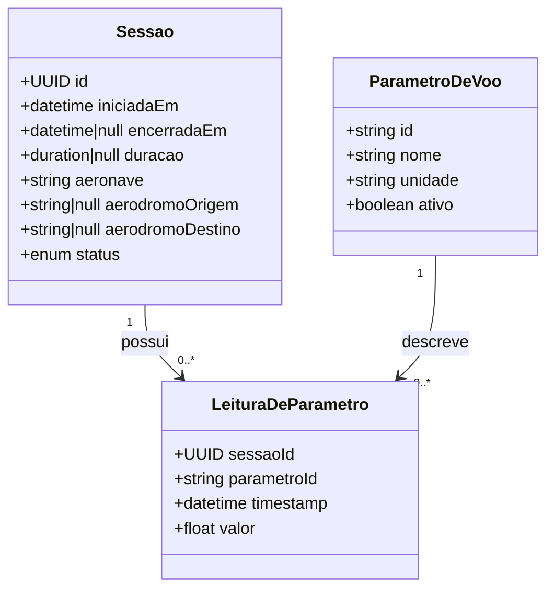

# Modelo de domínio

> Propósito: Entidades e dados que o produto trata, e como se relacionam.
> Atualizar quando: uma entidade, atributo ou relacionamento mudar.
> Relacionados: [../product/glossary.md](../product/glossary.md), [../product/business_rules.md](../product/business_rules.md)
> Última atualização: 2026-11-16 · loop-001

## Entidades

### Sessão
Representa um voo completo, do momento em que o motor é ligado até ser desligado.

| Atributo | Tipo | Descrição |
|----------|------|-----------|
| id | UUID | Identificador único gerado automaticamente |
| iniciadaEm | datetime (UTC) | Momento em que a coleta começou |
| encerradaEm | datetime (UTC) \| null | Momento em que a coleta encerrou; null se a sessão ainda está ativa |
| duracao | duration (s) | Calculado: encerradaEm − iniciadaEm; null enquanto ativa |
| aeronave | string | Nome da aeronave fornecido pelo simulador (ex.: "Cessna 172 Skyhawk") |
| aerodromoOrigem | string \| null | Código ICAO ou nome do aeródromo de saída, se disponível no simulador |
| aerodromoDestino | string \| null | Código ICAO ou nome do aeródromo de chegada, se disponível no simulador |
| status | enum: ativa \| encerrada | Estado atual da sessão |

---

### ParâmetroDeVoo
Descreve um tipo de grandeza que pode ser coletada do simulador.

| Atributo | Tipo | Descrição |
|----------|------|-----------|
| id | string (slug) | Identificador técnico do parâmetro (ex.: `altitude_msl`, `airspeed_ias`) |
| nome | string | Nome legível para exibição (ex.: "Altitude MSL", "Velocidade IAS") |
| unidade | string | Unidade de medida (ex.: "ft", "kt", "°", "fpm") |
| ativo | boolean | Indica se faz parte do conjunto inicial de parâmetros coletados |

Conjunto inicial de parâmetros (loop-001): `altitude_msl` (Altitude MSL, ft), `airspeed_ias` (Velocidade IAS, kt), `vertical_speed` (Velocidade vertical, fpm), `heading_magnetic` (Rumo magnético, °), `pitch` (Arfagem, °), `bank` (Rolagem, °).

---

### LeituraDeParâmetro
Valor de um parâmetro em um instante específico de uma sessão.

| Atributo | Tipo | Descrição |
|----------|------|-----------|
| sessaoId | UUID | Referência à Sessão à qual esta leitura pertence |
| parametroId | string (slug) | Referência ao ParâmetroDeVoo |
| timestamp | datetime (UTC) | Momento exato da leitura |
| valor | float | Valor numérico medido naquele instante |

Frequência de coleta: 1 leitura por segundo por parâmetro ativo (revisável nos ciclos de desenvolvimento).

## Relacionamentos

- Uma **Sessão** possui zero ou mais **LeituraDeParâmetro** (0..*).
- Cada **LeituraDeParâmetro** pertence a exatamente uma **Sessão** e a exatamente um **ParâmetroDeVoo**.
- **ParâmetroDeVoo** existe independentemente de sessões; é um catálogo fixo no código.

## Diagrama

