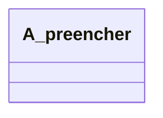

# Modelo de domínio

> Propósito: Entidades e dados que o produto trata, e como se relacionam.
> Atualizar quando: uma entidade, atributo ou relacionamento mudar.
> Relacionados: [../product/glossary.md](../product/glossary.md), [../product/business_rules.md](../product/business_rules.md)
> Última atualização: 2026-11-15 · fundação

## Entidades

<!-- a preencher -->

## Relacionamentos

<!-- a preencher -->

## Diagrama

