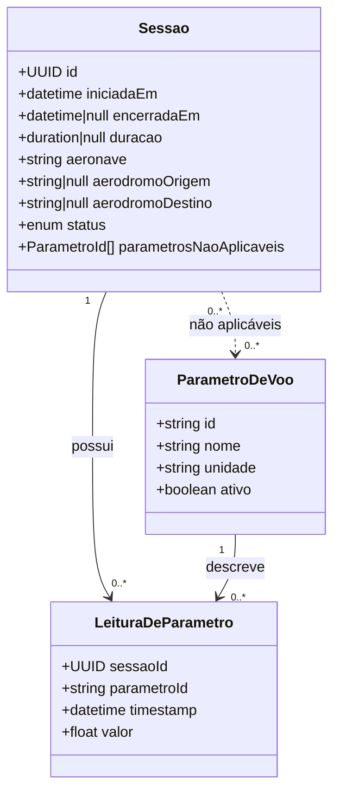

# Modelo de domínio

> Propósito: Entidades e dados que o produto trata, e como se relacionam.
> Atualizar quando: uma entidade, atributo ou relacionamento mudar.
> Relacionados: [../product/glossary.md](../product/glossary.md), [../product/business_rules.md](../product/business_rules.md)
> Última atualização: 2026-11-17 · loop-004

## Entidades

### Sessão
Representa um voo completo, do momento em que o motor é ligado até o encerramento (motor parado e aeronave no solo por 15 s seguidos, RN-004; ver ADR-009 em [architecture.md](architecture.md)).

| Atributo | Tipo | Descrição |
|----------|------|-----------|
| id | UUID | Identificador único gerado automaticamente |
| iniciadaEm | datetime (UTC) | Momento em que a coleta começou |
| encerradaEm | datetime (UTC) \| null | Hora de fim da sessão; null se a sessão ainda está ativa. A origem depende de como a sessão foi encerrada (ver "Encerramento da sessão" abaixo) |
| duracao | duration (s) | Calculado: encerradaEm − iniciadaEm; null enquanto ativa. Não é persistido. Inclui táxi e períodos sem sinal; o formato de exibição fica para o UC-004 |
| aeronave | string | Nome da aeronave fornecido pelo simulador (ex.: "Cessna 172 Skyhawk") |
| aerodromoOrigem | string \| null | Código ICAO ou nome do aeródromo de saída, se disponível no simulador |
| aerodromoDestino | string \| null | Código ICAO ou nome do aeródromo de chegada, se disponível no simulador |
| status | enum: ativa \| encerrada | Estado atual da sessão |
| parametrosNaoAplicaveis | ParametroId[] | Parâmetros que a aeronave da sessão não possui (RN-007), exibidos como "N/A". Decidido uma vez, ao ligar o motor, pelo perfil da aeronave, e válido a sessão toda (ver ADR-008 em [architecture.md](architecture.md)). Persistido na coluna `parametros_nao_aplicaveis` (TEXT com lista JSON, padrão `'[]'`). Sessões criadas antes da migration 002 ficam com `[]`. JSON inválido ou slug desconhecido lido do banco é descartado, com log |

Regra de N/A (loop-003): `mixture_1` é N/A se o motor não é a pistão; `flaps` é N/A se a aeronave não tem flapes. Manete, RPM, latitude, longitude e os 6 parâmetros do conjunto inicial nunca são N/A. Um 0 válido (flapes recolhidos, RPM 0) continua 0.

#### Encerramento da sessão (loop-004, UC-003)

- Transição única: `ativa → encerrada`. Uma sessão encerrada nunca volta a ativa; o religamento do motor sempre cria uma sessão nova, com UUID novo (RN-003). No banco, `encerrarSessao(id, encerradaEm)` só muda sessão com status `ativa` e lança erro se nenhuma linha mudar.
- O encerramento grava só `encerradaEm` e `status`; as leituras já foram gravadas a cada 1 s.
- Origem de `encerradaEm`:
  - Ao vivo (detector): o início do período de 15 s em que o motor está parado e a aeronave no solo, ou seja, o instante da primeira amostra em que as duas condições valem (o mais tarde entre o corte do motor e o toque no solo).
  - Na abertura do app (sessão restaurada com motor parado ou sem dado do motor em 15 s): a última leitura da sessão (`MAX(timestamp)`); sem leitura, `iniciadaEm` (duração 0).
  - Sessões ativas antigas (v0.1.0 a v0.3.0 e as que ficaram ativas por falha ao gravar o encerramento), encerradas pela rotina de cada abertura: a última leitura; sem leitura, `iniciadaEm` (duração 0).
- Leituras gravadas durante a espera de 15 s ficam com `timestamp` depois de `encerradaEm`. Elas são mantidas; o debriefing (UC-005) corta a exibição na hora de fim. Uma sessão de falha de gravação encerrada depois pela rotina fica com hora de fim até 15 s depois do início da espera, porque a última leitura inclui a espera.
- Toda sessão fica gravada, inclusive as muito curtas (RN-005). Ocultar voos curtos, se preciso, é filtro da lista de voos (UC-004).
- Há uma diferença de menos de 1 s entre a hora de fim e as leituras, porque motor, solo e parâmetros vêm de pedidos distintos ao SimConnect (débito do loop-004).
- No banco, a regra de no máximo uma sessão ativa é eventual: uma falha ao gravar o encerramento seguida de religamento deixa duas sessões ativas até a próxima abertura do app, quando a rotina as repara (ver Diretrizes em [architecture.md](architecture.md)).

---

### ParâmetroDeVoo
Descreve um tipo de grandeza que pode ser coletada do simulador.

| Atributo | Tipo | Descrição |
|----------|------|-----------|
| id | string (slug) | Identificador técnico do parâmetro (ex.: `altitude_msl`, `airspeed_ias`). Os slugs conhecidos estão em `PARAMETER_IDS` (`src/shared/parameter-ids.ts`), com o tipo `ParametroId`; o atributo ainda é tipado como `string` (ver "Em aberto" em [architecture.md](architecture.md)) |
| nome | string | Nome legível para exibição (ex.: "Altitude MSL", "Velocidade IAS") |
| unidade | string | Unidade de medida (ex.: "ft", "kt", "°", "fpm") |
| ativo | boolean | Indica se faz parte do conjunto inicial de parâmetros coletados |

Conjunto de parâmetros (12, todos com `ativo = true`):

| Slug | Nome | Unidade | Desde |
|------|------|---------|-------|
| `altitude_msl` | Altitude MSL | ft | loop-001 (migration 001) |
| `airspeed_ias` | Velocidade IAS | kt | loop-001 (migration 001) |
| `vertical_speed` | Velocidade vertical | fpm | loop-001 (migration 001) |
| `heading_magnetic` | Rumo magnético | ° | loop-001 (migration 001) |
| `pitch` | Arfagem | ° | loop-001 (migration 001) |
| `bank` | Rolagem | ° | loop-001 (migration 001) |
| `latitude` | Latitude | ° | loop-003 (migration 002) |
| `longitude` | Longitude | ° | loop-003 (migration 002) |
| `throttle_1` | Manete | % | loop-003 (migration 002) |
| `mixture_1` | Mistura | % | loop-003 (migration 002) |
| `rpm_1` | RPM | rpm | loop-003 (migration 002) |
| `flaps` | Flapes | % | loop-003 (migration 002) |

Os slugs com sufixo `_1` leem o motor 1 do simulador. O produto suporta, por enquanto, só aeronaves de um motor (decisão do HITL-3 do loop-003); o sufixo fica no slug e o rótulo não indica o motor.

O catálogo é semeado por migrations SQL (`INSERT OR IGNORE` em `parametros_de_voo`): a 001 traz os 6 primeiros, a 002 os 6 novos.

---

### LeituraDeParâmetro
Valor de um parâmetro em um instante específico de uma sessão.

| Atributo | Tipo | Descrição |
|----------|------|-----------|
| sessaoId | UUID | Referência à Sessão à qual esta leitura pertence |
| parametroId | string (slug) | Referência ao ParâmetroDeVoo |
| timestamp | datetime (UTC) | Momento exato da leitura |
| valor | float | Valor numérico medido naquele instante |

Frequência de coleta: 1 leitura por segundo por parâmetro ativo (revisável nos ciclos de desenvolvimento).

Índice `idx_leituras_sessao_timestamp` em `leituras_de_parametro (sessao_id, timestamp)`, criado pela migration 003 (loop-004), usado para buscar a última leitura de uma sessão (`buscarUltimaLeituraEm`, `MAX(timestamp)`) no encerramento na abertura e na rotina de sessões antigas.

Leituras só são gravadas com sessão ativa na memória do main: nenhuma leitura é gravada depois que a sessão sai da memória (encerramento ou falha ao gravá-lo), nem para a sessão restaurada enquanto ela está em verificação na abertura.

O `valor` é gravado bruto, como vem do SimConnect. Correções de sinal e arredondamentos para exibição (arfagem positiva com o nariz para cima; rolagem em valor absoluto com E/D; latitude e longitude com 5 casas e hemisfério em letra) são feitos só no renderer (decisões do HITL-1 do loop-002 e do loop-003). Latitude e longitude são gravadas com precisão total.

Parâmetro N/A na sessão (`Sessao.parametrosNaoAplicaveis`) não gera LeituraDeParâmetro nem entra no PacoteDeLeituras. Um 0 válido é gravado normalmente.

## Tipos de transporte

Não são entidades do domínio nem são persistidos. Existem só para levar dados do main ao renderer pelo IPC (ver ADR-007 em [architecture.md](architecture.md)) e vivem em `src/shared/types.ts`.

| Tipo | Forma | Uso |
|------|-------|-----|
| EstadoConexao | `'conectado' \| 'desconectado'` | Estado da conexão do main com o SimConnect; base do estado "sem sinal" do painel |
| PacoteDeLeituras | `{ sessaoId, timestamp, leituras: { parametroId, valor }[] }` | Leituras de um ciclo de coleta (1 s), enviadas ao renderer só com sessão ativa, num caminho separado da gravação das LeituraDeParâmetro no banco. Até 12 leituras; os parâmetros N/A da sessão ficam de fora |
| ParametroId | união dos slugs de `PARAMETER_IDS` | Identificador de parâmetro conhecido, em `src/shared/parameter-ids.ts`. Usado em `Sessao.parametrosNaoAplicaveis` |

Tipo interno do main (não vai ao renderer): `PerfilDaAeronave = { motorAPistao, temFlapes }`, lido do simulador ao ligar o motor e usado só para derivar `parametrosNaoAplicaveis` (`src/main/simconnect/parametros-nao-aplicaveis.ts`).

Tipos internos do main do loop-004 (não vão ao renderer): `AmostraDoMotor = { combustao, timestamp }` e `AmostraDoSolo = { noSolo, timestamp }` (`simconnect-client.ts`), uma por leitura de 1 s; `EstadoDetector = { motorLigado, noSolo, inicioCondicao }` e `EventoDetector` (`motor`, `solo`, `conexao-perdida`), do detector de encerramento (`detector-de-encerramento.ts`, ADR-009).

No renderer, depois de um `session:end-failed`, a `Sessao` é exibida com `status: 'encerrada'` e `encerradaEm: null`. É estado de exibição: no banco ela continua ativa até a próxima abertura do app.

## Relacionamentos

- Uma **Sessão** possui zero ou mais **LeituraDeParâmetro** (0..*).
- Cada **LeituraDeParâmetro** pertence a exatamente uma **Sessão** e a exatamente um **ParâmetroDeVoo**.
- **ParâmetroDeVoo** existe independentemente de sessões; é um catálogo fixo, semeado pelas migrations SQL, com os slugs espelhados em `PARAMETER_IDS`.
- Uma **Sessão** referencia zero ou mais **ParâmetroDeVoo** como não aplicáveis (`parametrosNaoAplicaveis`, lista de slugs guardada na própria sessão, sem tabela de ligação).

## Diagrama

